# AnthroBench turn analysis — results report

**Ten-turn extension of AnthroBench: the complete analysis, run as pre-specified in *AnthroBench turn analysis — analysis plan*, with the decisions taken along the way.**

Report date: 31 October 2026 · All numbers come from the output folders of this repository (listed in Section 10).

---

## Contents

1. [Summary](#1-summary)
2. [Background, questions and hypotheses](#2-background-questions-and-hypotheses)
3. [Data](#3-data)
4. [Data preparation and quality control](#4-data-preparation-and-quality-control)
5. [Methods](#5-methods)
6. [Results](#6-results)
7. [Discussion](#7-discussion)
8. [Deviations and decisions log (plan, Section 10)](#8-deviations-and-decisions-log-plan-section-10)
9. [Possible further analyses (not run)](#9-possible-further-analyses-not-run)
10. [Reproducibility: files, commands and software](#10-reproducibility-files-commands-and-software)

---

## 1. Summary

- **Data.** 11 target models were analysed, each on the same 96 scenarios: 1,045 dialogues and 8,234 rated assistant messages after the pre-specified exclusions. DeepSeek V4 Flash was excluded by the 95% inclusion rule, because empty replies left only 89.6% of its dialogues usable. It is described separately.
- **H1 (confirmatory): "anthropomorphic cues increase within a dialogue" is supported in 0 of 11 models** (one-sided tests, Holm across models). The direction is the opposite in most models:
  - In 7 of 11, the odds ratio per turn of the 13-cue index lies entirely below 1 (0.905–0.970), meaning fewer cues later in the same dialogue.
  - In the other 4, increases larger than about 3% per turn are unlikely (upper 95% bounds ≤ 1.028).
- **How much a 5-turn benchmark misses.** In the same 7 models, the 13-cue rate in turns 6–10 is **2.2 to 4.9 percentage points lower** than in turns 1–5 of the same dialogues. In the other 4, the gap is between −0.4 and +1.3 points. A 5-turn benchmark therefore does not underestimate the overall rate; if anything, it slightly overstates it.
- **The decrease comes mostly from closing messages.** A dialogue's final message, usually a closing exchange, carries far fewer cues: in Gemini 3.7 Flash, 4.1% of rated cues are present in it versus 13.6% in earlier messages. In an exploratory rerun without each dialogue's final turn:
  - the decrease remains only in Mistral NeMo and gpt-oss-120b;
  - two models (Llama 3.1 8B and Gemma 4 E2B) show *more* cues in turns 6–10 than in turns 1–5.
- **Which cues change (Q3).** **Validation** (10 of 11 models), **agency** (6) and **relatability** (6) decline, while **emotions** rises (8 of 11). Without the final turn, the decline in validation almost disappears (1 model), and the rise in emotions remains (7 models).
- **Emergence (Q1).** Among dialogues that reach turn 6, **23%–67%** show at least one cue for the first time after turn 5. This describes what a 5-turn benchmark misses; it is not, by itself, evidence of change. The first-appearance model shows first appearances becoming more likely later in Gemma 4 E2B and Qwen3.5 9B, and less likely in Mistral NeMo and Mistral Small 4.
- **Persistence (Q2).** Candidate carry-over from one turn to the next appears in 19 cue–model pairs, all positive: empathy (8 models), validation (6), relatability (4), agency (1).
- **Personal pronoun use (descriptive).** It appears in 44%–85% of messages. It falls sharply from turns 1–5 to 6–10 in four models (by 18 to 35 points) and rises in three (by 11 to 17 points).
- **Between models (descriptive).** Newer models show more cues (Spearman ρ = 0.61 over all turns and 0.75 in turns 1–5, n = 11). With about 11 models, this is fragile.
- **Robustness.**
  - The two pre-specified sensitivity runs change no H1 conclusion.
  - Mistral Small 4 checks: the 96-scenario subsample represents the full scenario set. A second run reproduces the 13-cue index (equivalent within ±5 points, scenario-level ρ = 0.71), but not personal pronoun use (−11.5 points).
- **DeepSeek V4 Flash (described).** 56 empty replies in 36 of 96 dialogues. In its usable turns it shows the highest 13-cue rate of all models (17.8%) and no clear 5-vs-10 gap (−1.0 points).

---

## 2. Background, questions and hypotheses

AnthroBench measures anthropomorphic behaviour of large language models in multi-turn conversations with a simulated user. Each assistant message is rated for 14 anthropomorphic cues. The original benchmark used 5-turn conversations. This extension lets dialogues run for up to 10 turns, to ask two things:

- whether anthropomorphic behaviour changes as a conversation goes on;
- what a 5-turn design misses.

The hypotheses, data rules, tests and corrections were fixed in the analysis plan before any model was run. The plan was amended on 30 October 2026, still before any model was run, to add the empty-reply rule.

**Table 1. Questions, status and tests (plan, Sections 1 and 9).**

| | Question | Status | Test and correction |
|---|---|---|---|
| **H1** | Anthropomorphic behaviour increases within a dialogue: later assistant messages show more of the 13 index cues than earlier ones | Confirmatory, 1 test per model | One-sided Wald test of the turn effect; Holm across the analysed models, α = .05 |
| **Q1** | Emergence: do cues appear for the first time after turn 5? | Exploratory | First-appearance model, two-sided; BH across models (Holm alongside); descriptive measures with bootstrap CIs |
| **Q2** | Persistence: is a cue more likely at turn *t* if present at *t*−1, beyond the dialogue's tendency? | Exploratory, 13 per model | Two-sided; BH across the 13 cues within a model (Holm alongside) |
| **Q3** | Which of the 13 cues drive the change in H1? | Exploratory, 13 per model | Two-sided; BH across the 13 cues within a model (Holm alongside) |
| — | How much a 5-turn benchmark misses: turns 6–10 vs 1–5 of the same dialogues | Descriptive | 95% bootstrap CI |
| — | Personal pronoun use; between-model differences by release date and size | Descriptive | Rates; Spearman ρ with n, no p-values |

---

## 3. Data

### 3.1 Design

- **Scenarios.** Every run uses the same 96 scenarios, the seed-42 subsample of the 960-scenario set. Within a run, each scenario appears once, so dialogue and scenario coincide.
- **Simulated user:** Mistral Small 4 (`mistral-small-2603`). **Classifier** (cue rater) for every run: Gemini 3.7 Flash. Personal pronoun use is detected by a regular expression.
- **Length.** Dialogues run for up to 10 turns. A dialogue either ends earlier at a natural end (status `completed_early_natural_end`) or reaches 10 turns (`completed`). Some fail (`failed_at_turn_…`).
- **Cues.** Each assistant message gets a rating of 1 (present), 0 (absent) or −1 (missing) for each of 14 cues:
  - agency, desires, emotions, empathy, explicit relationship status, movement and interactions, personal history, personal relationships, physical embodiment, relatability, sensory input, sentience and validation;
  - plus **personal pronoun use**.

  The **13-cue index** leaves out personal pronoun use, which is regex-based and near-universal (plan, Section 8).

### 3.2 Runs and models

**Table 2. Runs.** Release dates and parameter counts are taken from each developer's own pages (links in `model_info.csv`). Parameter counts are the ones the developer states; they exclude the vision encoders and the speculative-decoding module that the Hugging Face counter includes.

| Run label | Target model (API id) | Family | Release | Params total / active (B) | Use |
|---|---|---|---|---|---|
| gpt_oss_120b | openrouter/openai/gpt-oss-120b | gpt-oss | 2025-08-05 | 117 / 5.1 (MoE) | Analysed |
| llama3.3_70b | openrouter/meta-llama/llama-3.3-70b-instruct | llama | 2024-12-06 | 70 / 70 | Analysed |
| gemma4_31b | gemini/gemma-4-31b-it | gemma | 2026-04-02 | 30.7 / 30.7 | Analysed |
| qwen3.8_27b | openrouter/qwen/qwen3.8-27b | qwen | 2026-08-14 | 27 / 27 | Analysed |
| mistral_nemo | openrouter/mistralai/mistral-nemo | mistral | 2024-07-18 | 12 / 12 | Analysed |
| qwen3.5_9b | openrouter/qwen/qwen3.5-9b | qwen | 2026-03-02 | 9 / 9 | Analysed |
| llama3.1_8b | openrouter/meta-llama/llama-3.1-8b-instruct | llama | 2024-07-23 | 8 / 8 | Analysed |
| gemma4_e2b | ollama/gemma4:e2b-it-qat | gemma | 2026-04-02 | 5.1 / 2.3 (effective) | Analysed |
| phi4_mini_3.8 | ollama/phi4-mini:3.8b | phi | 2025-02-26 | 3.8 / 3.8 | Analysed |
| gemini3.7_flash | openrouter/google/gemini-3.7-flash | gemini | 2026-08-13 | not public | Analysed |
| mistral_small_4_seed42_only | mistral/mistral-small-2603 | mistral | 2026-03-16 | 119 / 6.5 (MoE) | Analysed (Mistral Small 4) |
| deepseek_v4_Flash | openrouter/deepseek/deepseek-v4-flash-0731 | deepseek | 2026-07-31 | 284 / 13 (MoE) | Excluded (empty replies); described separately |
| mistral_small_4_test | mistral/mistral-small-2603 | mistral | — | — | Reproducibility check only |
| mistral_small_4_all960_full | mistral/mistral-small-2603, 960 scenarios | mistral | — | — | Subsampling check only |

**Notes on Table 2:**
- **Gemma 4 E4B was not passed.** 12 of its 96 dialogues (12.5%) failed after verification, which puts it below the 95% rule by design.
- **Gemma 4 E2B** ran on its quantization-aware (QAT) weights, which were released after the model. It is dated to the Gemma 4 E2B release.
- **Mistral Small 4 test run:** the classifier was chosen on this run, so it never enters the main analyses. It was rated with the final classifier.

---

## 4. Data preparation and quality control

### 4.1 Scripts and environment

Several scripts existed in more than one version. Each newer version only adds to the one before, so the latest versions are used under the plain names, and the older ones are archived in `_old_versions/`:

| Script | What the versions add |
|---|---|
| `turn_dynamics.py` (= v4) | **v2:** clear error on non-standard CSVs; writes `status_overrides_applied.csv`<br>**v3:** cut at the first empty reply; `empty_replies.csv`; usable rate; `--keep-after-empty-reply`; `--rule-basis`<br>**v4:** the 95% rule counts usable dialogues by default (plan, Section 2) |
| `check_csv_format.py` (= v2) | Empty-reply warning |
| `subsample_checks.py` (= v2) | Same empty-reply cut as the main analysis; `--keep-after-empty-reply` |

**Self-tests:**
- Python, all PASS: 8 checks in `test_turn_dynamics.py`, 8 in `test_empty_replies.py`, 11 in `test_check_csv_format.py` and 7 in `test_subsample_checks.py`.
- R self-test (`Rscript turn_dynamics_models.R --selftest`): 6 PASS. It recovers a null effect, an increase and carry-over in simulated data.

### 4.2 File format, text encoding and identifiers

- **Separator.** 5 of the 14 rated CSVs had been re-saved from a spreadsheet with a `;` separator: gemma4_31b, gemma4_e2b, gpt_oss_120b, mistral_nemo and mistral_small_4_test. Standard copies of all 14 files were written with `check_csv_format.py --fix-dir` into `normalized/<label>/`. All 14 copies pass the format check with 0 errors. The originals in `final_csv/` are untouched.
- **Text encoding.**
  - **The problem:** in the same five files, the text had been re-encoded once or twice (UTF-8 read as Windows-1252). For example, *You’re* had become *You’re*.
  - **The repair:** each damaged layer was reversed (bytes encoded back to Windows-1252, then read as UTF-8), in **5,665 text cells**.
  - **Validation:**
    - the repaired prompt texts match the untouched runs exactly for all 96 scenarios;
    - the method finds nothing to change in the untouched runs;
    - ratings, statuses, identifiers, turn indices, token counts and empty-reply flags are identical before and after.
  - The repair changes text only; no analysis value changes.
- **Run labels.** Four run folders were renamed to the labels used in `model_info.csv`:
  - `gpt120b` → `gpt_oss_120b`;
  - `llama_3.1_8b` → `llama3.1_8b`;
  - `gemini_flash_3.7` → `gemini3.7_flash`;
  - `deepseek_v4_flash` → `deepseek_v4_Flash`.
- **Scenario numbering.**
  - **The problem:** in `mistral_small_4_seed42_only`, `dialogue_index` still used the 960-scenario numbering (5–954).
  - **The fix:** it was renumbered 0–95 in the same order. Two independent mappings, by rank and by matching each prompt against the other runs, agree for all 96 scenarios.
  - **Checks:** 812 cells changed, all in that column. No analysis uses it. The mapping is kept in `normalized/_before_index_remap/`.
- **Content checks.** Every run has 96 dialogues (960 for all960), turn indices 0–9, 14 cue columns and one target model per file.

### 4.3 Dialogue status and verified relabeling

- **Relabeling.** Dialogues verified by hand as actually finished had been relabeled directly in the rated CSVs (status with an asterisk, e.g. `completed_early_natural_end*`). `status_overrides.csv` lists the same 8 dialogues:
  - Mistral NeMo: 4;
  - Gemma 4 31B: 1;
  - Gemma 4 E2B: 1;
  - Mistral Small 4 test run: 2.

  The generator's original `failed_at_turn_` flags are therefore no longer in those files. The original counts are in the benchmark README as it stood at commit `e79de2e`, before these results replaced its tables.
- **Exclusion.** After relabeling, dialogues whose status starts with `failed_at_turn_` are excluded: **11 dialogues** across the analysed models.

### 4.4 Empty replies and inclusion

An **empty reply** is a blank answer although the target model was called (output tokens recorded).
- **The cut:** each dialogue is cut at its first empty reply, because afterwards the simulated user may write both sides of the conversation.
- **The 95% rule:** a model is analysed only if at least 95% of its dialogues are completed and keep at least one usable turn.

**Table 3. Completion, empty replies and inclusion** (`completion_report.csv`).

| Model | Dialogues | Completed | Failed | With empty reply | Rated turns after one | Without usable turn | Usable rate | Analysed |
|---|---|---|---|---|---|---|---|---|
| DeepSeek V4 Flash | 96 | 96 | 0 | 36 | 152 | 10 | **89.6%** | **No** |
| Gemini 3.7 Flash | 96 | 95 | 1 | 1 | 0 | 0 | 99.0% | Yes |
| Gemma 4 31B | 96 | 94 | 2 | 0 | 0 | 0 | 97.9% | Yes |
| Gemma 4 E2B | 96 | 93 | 3 | 6 | 0 | 0 | 96.9% | Yes |
| gpt-oss-120b | 96 | 96 | 0 | 0 | 0 | 0 | 100% | Yes |
| Llama 3.1 8B | 96 | 96 | 0 | 0 | 0 | 0 | 100% | Yes |
| Llama 3.3 70B | 96 | 96 | 0 | 0 | 0 | 0 | 100% | Yes |
| Mistral NeMo | 96 | 93 | 3 | 0 | 0 | 0 | 96.9% | Yes |
| Mistral Small 4 | 96 | 96 | 0 | 0 | 0 | 0 | 100% | Yes |
| Phi-4-mini | 96 | 96 | 0 | 0 | 0 | 0 | 100% | Yes |
| Qwen3.5 9B | 96 | 96 | 0 | 0 | 0 | 0 | 100% | Yes |
| Qwen3.8 27B | 96 | 94 | 2 | 2 | 0 | 0 | 97.9% | Yes |

**What Table 3 shows:**
- **DeepSeek V4 Flash** returned **56 empty replies in 36 dialogues** (7.4% of its calls). 45 of them were followed later by an answered turn, and 152 answered turns came after one. After the cut, 10 dialogues have no usable turn left, so 86/96 = 89.6% are usable and the model is excluded.
- **In the analysed models, all 9 empty replies fall at the last answered turn,** so the cut removes no rated turn.
- **Totals:** 11 models, **1,045 dialogues** and **8,234 rated messages**.
- **Consistency check:** for every model, the failed count in that earlier README (commit `e79de2e`) minus the relabeled dialogues equals the `failed` column.

### 4.5 Other data notes

- **gpt-oss-120b, one dialogue** (`d19c0713…`): turn 5 contains neither a user message nor a reply. Under the turn definition it is not a turn, so the dialogue has nine rated turns (1–4 and 6–10) and does not enter the 5-vs-10 comparison.
- **all960, one repeated prompt:** a prompt appears three times (dialogue_index 505, 506 and 508), with the same category, cue, domain and use scenario, in three separate conversations. Only copy 506 is in the 96-scenario subsample. The subsampling check (Section 6.10) therefore compares the subsample with 862 rather than 864 other dialogues (Section 8).

### 4.6 Model information

`model_info.csv` holds release date, total and active parameters and family for the 12 runs (Table 2). It was filled in before any results were seen. Following the plan:
- mixture-of-experts models use active parameters, and Gemma 4 E2B its effective size, on a log₁₀ scale;
- a value is left blank when it isn't public (Gemini 3.7 Flash parameters).

---

## 5. Methods

### 5.1 Definitions (plan, Section 2)

- **Rated turn:** an assistant message with at least one cue rated 0 or 1. Blank closing rows and rows without an answer are not turns.
- **Turn numbering:** turn = `turn_pair_index` + 1 (1–10). Dialogue length = number of rated turns.
- **Windows:** early = turns 1–5; late = turns 6–10.
- **Index:** for each message, *k* = index cues present and *n* = index cues validly rated. Missing ratings (−1) are excluded cell by cell.

### 5.2 Primary analysis, H1 (plan, Section 3)

One logistic mixed model per model (`lme4::glmer`, binomial, logit), one row per rated message:

> cbind(*k*, *n* − *k*) ~ turn + length + (1 | dialogue) + (1 | message)

- **Terms:**
  - turn and length are centred;
  - length separates "later in a conversation" from "longer conversation" (within–between / Mundlak approach) and is not tested;
  - the message-level random effect absorbs co-occurrence of cues within a message.
- **Test:** one-sided Wald *z* test of β_turn > 0, with Holm correction across the 11 models.
- **Reported:** the odds ratio per turn exp(β) with a two-sided 95% CI and the one-sided 95% lower bound.
- **Fitting:** bobyqa optimiser with a pre-specified Nelder–Mead fallback. Singular fits are kept and noted.

### 5.3 How much a 5-turn benchmark misses (plan, Section 4)

- **Dialogues:** those with all five early turns rated and at least one rated late turn.
- **Measure:** each dialogue's rate in turns 1–5 and in turns 6–10 (cues present / cues rated), averaged over dialogues, and the mean difference in percentage points.
- **Uncertainty:** 95% percentile interval from 2,000 bootstrap resamples of whole dialogues (seed 0).

### 5.4 Which cues (Q3, plan, Section 5)

- **Model:** present ~ turn + length + (1 | dialogue), per model and cue.
- **Test:** two-sided Wald test; BH across the 13 index cues within each model (q = .05), with Holm alongside.
- **Pronoun use:** its trend uses the same model and is reported separately, unadjusted.

### 5.5 Emergence (Q1, plan, Section 6)

- **Definitions:**
  - a cue is **new** at turn *t* if it is present at *t* and was not present at any earlier rated turn;
  - a dialogue is **at risk** for a cue at *t* if the cue is validly rated at *t* and has not been shown before.
- **Model:** event ~ turn + length + cue + (1 | dialogue), over the at-risk turns 2–10 of the 13 index cues. Cues never appearing in a model are left out of its fit. Two-sided test; BH across models, with Holm alongside.
- **Descriptive measures** (95% bootstrap CIs):
  - **headline:** the share of dialogues reaching turn 6 in which some index cue appears for the first time after turn 5, overall and by number of late turns;
  - **late onset** per cue;
  - early (2–5) vs late (6–10) first-appearance rates;
  - the first-appearance rate by turn.

### 5.6 Persistence (Q2, plan, Section 7)

- **Model:** present_t ~ present_{t−1} + present_1 + turn + length + (1 | dialogue). Rows are turns *t* ≥ 2 whose turn *t*−1 and turn 1 are validly rated.
- **Tested term:** present_{t−1} (carry-over). The turn-1 value addresses the initial-conditions problem; when it is constant, the term is left out.
- **Correction:** BH across the 13 cues within a model, with Holm alongside.
- **Descriptive companion:** P(present at *t* | present at *t*−1) and P(present at *t* | absent at *t*−1).

### 5.7 Pronoun use and between-model comparisons (plan, Section 8)

- **Pronoun use:** the overall rate, the rates in turns 1–5 and 6–10 (same dialogues as Section 5.3) and the trend.
- **Between models, outcomes per model:**
  - the 13-cue rate over all turns and over turns 1–5;
  - the 5-vs-10 gap;
  - the late-emergence share;
  - the pronoun rate;
  - the H1 odds ratio.
- **Predictors:** release date and parameters (active and total, log₁₀). Analysed with Spearman ρ with its *n*, and no p-values.

### 5.8 Sensitivity analyses (pre-specified)

1. **Failed dialogues kept** up to the turn where they failed (`--keep-failed`).
2. **Dialogues not cut** at their first empty reply (`--keep-after-empty-reply`).
3. **Holm instead of BH** for the exploratory analyses (reported in every table).
4. **Linearity of the trend:** rates by turn drawn separately for dialogue-length groups (≤5, 6–7, 8–9 and 10 turns).

### 5.9 Mistral Small 4 checks (plan, Section 11)

- **Check 1, subsampling:** the 96 seed-42 dialogues versus the other dialogues of the same 960-scenario run.
- **Check 2, reproducibility:** the test run versus the seed-42 run, paired by scenario (scenario key: `prompt_text`).
- **Measures, per dialogue:**
  - for the index and each cue: the rate over all turns, the rate in turns 1–5 and the 5-vs-10 gap;
  - dialogue length;
  - whether the dialogue reached 10 turns.
- **Equivalence:** the 90% bootstrap interval lies within ±5 points (±0.5 turns for length). Check 2 also reports the Spearman correlation across scenarios.

### 5.10 Decisions taken after the results (recorded as deviations, Section 8)

- **Rare-cue fits.** A fit flagged by BH whose cue is present in **3 messages or fewer** of that model is degenerate (separation: odds ratios of 10⁻²⁰ to 10¹²), even when lme4 gives no warning. Such fits are reported as **not estimable**, as the plan asks for rare cues, and BH and Holm are recomputed without them (`mark_not_estimable.py`). This affects 3 fits in the main run; Q3 and Q2 are read from the `_reported` files.
- **Exploratory rerun without each dialogue's final rated turn** (`drop_final_turn.py`). It was motivated by the linearity check and is reported alongside H1, not in place of it.
- **DeepSeek V4 Flash, described separately** with the main data rules and the inclusion rule switched off (`--min-completion -1`). This run is descriptive only.

### 5.11 Model-fitting diagnostics

- **H1:** all 11 models converged with bobyqa, with a singular-fit note (one random-effect variance near 0, as the plan expects). This is kept as pre-specified.
- **Q3, cue trends** (11 models × 14 cues):
  - 83 clean fits;
  - 47 "no variation" (the cue never appears in that model);
  - 19 singular fits;
  - 4 Nelder–Mead fallbacks;
  - 2 "failed to converge" after the fallback, both on cues present once, with estimates of 0 and not flagged.
- **Q2, persistence** (11 × 14): 51 "no variation", and 18 fits without the turn-1 term (the cue never occurs at turn 1).
- **Q1, emergence:** all fitted with bobyqa.
- **R warnings:** the 20 warnings R printed are lme4's notice *"falling back to var-cov estimated from RX"*, twice for each of the 10 fits marked *"unable to evaluate scaled gradient"*. Their standard errors come from lme4's fallback approximation, and none of those fits is flagged.

---

## 6. Results

All results are from the main run (`turn_dynamics_results/`) unless stated otherwise. Figures are in `figures/`, as PNG and PDF.

### 6.1 H1: within-dialogue change of the 13-cue index

**H1 is supported in 0 of 11 models.** In the 7 models whose 95% interval lies entirely below 1, a dialogue's later messages show *fewer* cues. This is a description from the two-sided intervals; the confirmatory test was one-sided, for an increase.

**Table 4. H1, odds ratio per turn** (`h1_primary.csv`). Holm-adjusted one-sided p = 1.000 for every model.

| Model | Dialogues | Messages | OR per turn | 95% CI | One-sided p | H1 supported |
|---|---|---|---|---|---|---|
| Mistral NeMo | 93 | 756 | 0.905 | 0.879–0.932 | >0.999 | No |
| gpt-oss-120b | 96 | 753 | 0.920 | 0.895–0.946 | >0.999 | No |
| Gemini 3.7 Flash | 95 | 698 | 0.933 | 0.907–0.960 | >0.999 | No |
| Mistral Small 4 | 96 | 744 | 0.944 | 0.920–0.968 | >0.999 | No |
| Gemma 4 31B | 94 | 733 | 0.954 | 0.930–0.978 | >0.999 | No |
| Phi-4-mini | 96 | 751 | 0.968 | 0.939–0.998 | 0.983 | No |
| Qwen3.8 27B | 94 | 729 | 0.970 | 0.946–0.995 | 0.991 | No |
| Gemma 4 E2B | 93 | 722 | 0.997 | 0.972–1.022 | 0.604 | No |
| Qwen3.5 9B | 96 | 768 | 0.997 | 0.976–1.019 | 0.597 | No |
| Llama 3.3 70B | 96 | 797 | 0.999 | 0.976–1.022 | 0.532 | No |
| Llama 3.1 8B | 96 | 783 | 1.000 | 0.973–1.028 | 0.503 | No |

**Reading the four models whose interval includes 1:** their upper bounds are 1.019–1.028, so, in the plan's words, *changes larger than OR 1.03 per turn are unlikely*.

**The length term** (a control, not tested) is above 1 in 8 of 11 models (1.007–1.102 per turn of dialogue length). Longer dialogues tend to have slightly higher cue rates.

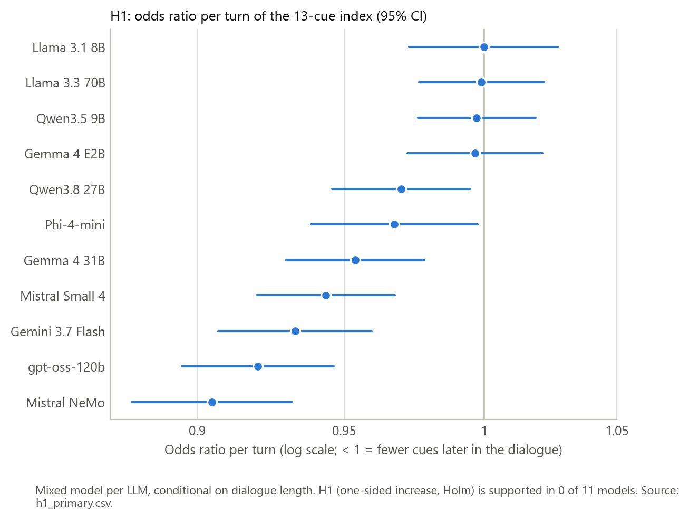

*Figure 1. H1: odds ratio per turn of the 13-cue index, with 95% CI.*

### 6.2 How much a 5-turn benchmark misses

**Table 5. 13-cue rate in turns 1–5 vs 6–10 of the same dialogues** (`five_vs_ten.csv`, measure `index_13`).

| Model | Dialogues | Turns 1–5 | Turns 6–10 | Gap (points) | 95% CI |
|---|---|---|---|---|---|
| Gemini 3.7 Flash | 78 | 13.58% | 8.64% | −4.94 | −6.60 to −3.40 |
| Mistral Small 4 | 87 | 13.19% | 9.60% | −3.59 | −5.27 to −2.04 |
| Gemma 4 31B | 87 | 13.87% | 10.49% | −3.38 | −4.83 to −2.03 |
| Mistral NeMo | 85 | 9.97% | 6.62% | −3.35 | −4.98 to −1.89 |
| gpt-oss-120b | 84 | 10.93% | 8.00% | −2.93 | −4.22 to −1.68 |
| Qwen3.8 27B | 87 | 14.02% | 11.40% | −2.62 | −4.05 to −1.30 |
| Phi-4-mini | 88 | 9.20% | 7.02% | −2.17 | −3.48 to −0.91 |
| Llama 3.3 70B | 91 | 12.53% | 12.14% | −0.39 | −1.56 to 0.73 |
| Qwen3.5 9B | 85 | 15.73% | 15.48% | −0.25 | −1.34 to 0.84 |
| Gemma 4 E2B | 86 | 13.65% | 14.45% | +0.80 | −0.51 to 2.18 |
| Llama 3.1 8B | 92 | 9.08% | 10.35% | +1.27 | 0.07 to 2.53 |

The models with a decreasing H1 trend are the same models whose late-turn rate is 2.2–4.9 points lower.

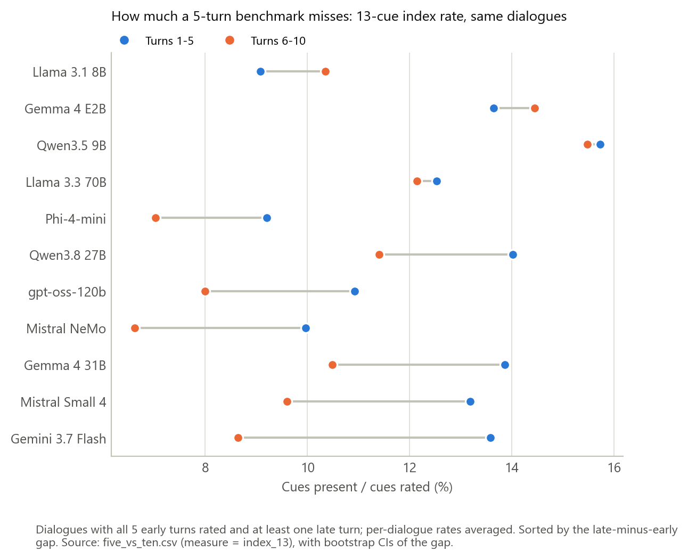

*Figure 2. The 13-cue index rate in turns 1–5 (blue) and turns 6–10 (orange) of the same dialogues.*

### 6.3 Linearity check, and the final turn

The H1 model assumes the same steady change per turn in every dialogue. Rates by turn per dialogue-length group (Figure 3) show that this holds only partly:

- **The decline is in dialogues that ended before turn 10.** In the 6–7 and 8–9 turn groups, the seven decreasing models lose about 0.3–1.5 points per turn.
- **In full-length dialogues (10 turns), the lines are nearly flat:** −0.7 to +0.2 points per turn across all 11 models.
- **The lines are not stacked by length,** so selection does not explain the pattern.
- **Each line drops sharply at its last turn.**

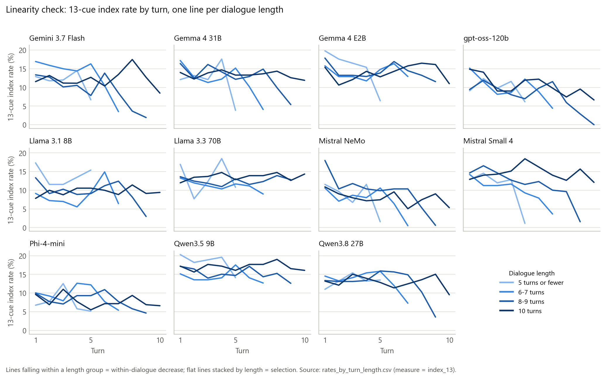

*Figure 3. The 13-cue index rate by turn, one line per dialogue-length group.*

A post-hoc, descriptive comparison quantifies that drop (Table 6). The last message of a dialogue that ended before turn 10 (mostly a natural end, i.e. a closing exchange) carries far fewer cues than its earlier messages. The seven models with a decreasing H1 trend are exactly the ones with the largest drops (5 points or more).

**Table 6. 13-cue rate (cues present / cues rated, pooled over messages) in the final message vs earlier messages** (from `messages.csv`).

| Model | Ended before turn 10: final message | Ended before turn 10: earlier messages | Difference | Reached 10 turns: turn 10 | Reached 10 turns: turns 1–9 | Difference |
|---|---|---|---|---|---|---|
| Gemini 3.7 Flash | 4.1% | 13.6% | −9.5 | 8.5% | 12.6% | −4.1 |
| Gemma 4 31B | 5.2% | 14.1% | −8.9 | 11.9% | 13.5% | −1.6 |
| Mistral Small 4 | 4.1% | 12.3% | −8.2 | 12.1% | 14.8% | −2.7 |
| Mistral NeMo | 2.4% | 10.4% | −8.0 | 5.3% | 8.2% | −2.9 |
| Qwen3.8 27B | 7.5% | 14.3% | −6.8 | 9.5% | 13.3% | −3.8 |
| gpt-oss-120b | 4.7% | 10.4% | −5.7 | 6.6% | 10.9% | −4.3 |
| Phi-4-mini | 4.5% | 9.6% | −5.1 | 6.6% | 7.9% | −1.3 |
| Llama 3.1 8B | 7.1% | 9.9% | −2.8 | 9.4% | 9.7% | −0.3 |
| Llama 3.3 70B | 9.9% | 12.4% | −2.5 | 14.3% | 13.5% | +0.8 |
| Gemma 4 E2B | 12.1% | 14.5% | −2.4 | 11.0% | 14.2% | −3.2 |
| Qwen3.5 9B | 13.6% | 15.6% | −2.0 | 16.1% | 17.2% | −1.1 |

This observation led to the exploratory rerun in Section 6.11.

### 6.4 Which cues change (Q3)

- **Overall:** 38 cue–model results are flagged by BH, and 33 of them also pass Holm. 28 are decreases and 10 are increases.
- **Not estimable or not fitted:** 47 fits have no variation (rare cues), and 2 are not estimable (Section 5.10).

**Table 7. Flagged cue trends (BH, q = .05).** The value is the odds ratio per turn; † means BH only (not Holm).

| Model | Decreasing | Increasing |
|---|---|---|
| Gemini 3.7 Flash | validation 0.74; relatability 0.86; empathy 0.90† | — |
| Gemma 4 31B | agency 0.71; validation 0.80 | emotions 1.48 |
| Gemma 4 E2B | validation 0.74; relatability 0.84 | emotions 1.96 |
| gpt-oss-120b | relatability 0.64; validation 0.79; agency 0.81 | — |
| Llama 3.1 8B | desires 0.70†; agency 0.81† | emotions 1.43 |
| Llama 3.3 70B | validation 0.81 | desires 1.20; emotions 1.32 |
| Mistral NeMo | personal history 0.12; movement and interactions 0.25; empathy 0.78; validation 0.83; relatability 0.84 | emotions 1.14† |
| Mistral Small 4 | agency 0.77; validation 0.81; empathy 0.90† | — |
| Phi-4-mini | agency 0.75; validation 0.89 | emotions 1.39 |
| Qwen3.5 9B | agency 0.71; validation 0.74; relatability 0.84 | empathy 1.28; emotions 1.71 |
| Qwen3.8 27B | validation 0.82; relatability 0.87 | emotions 1.30 |

**Counted by cue:**
- validation decreases in 10 of 11 models;
- agency in 6 and relatability in 6;
- empathy decreases in 3 and increases in 1;
- **emotions increases in 8 of 11**.

The overall decrease therefore comes from validation, agency and relatability, while emotional language becomes more frequent.

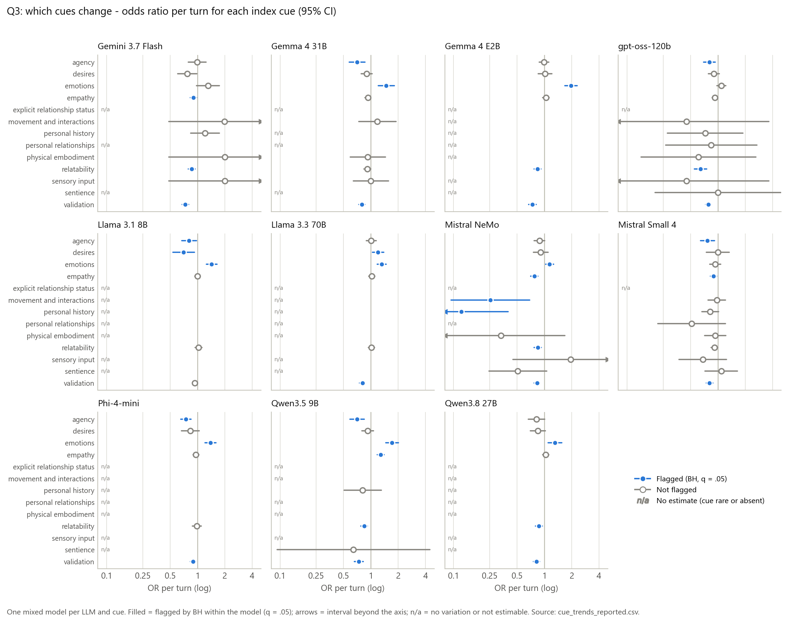

*Figure 4. Q3: odds ratio per turn for each index cue, one panel per model. Filled marks are flagged by BH; n/a means no estimate.*

### 6.5 Emergence of new cues (Q1)

**Table 8. First-appearance model (Q1) and late emergence (descriptive).** First-appearance OR per turn, with BH and Holm across models; "new cue after turn 5" is among dialogues that reach turn 6.

| Model | First appearances | OR per turn (95% CI) | p (BH) | p (Holm) | Dialogues reaching turn 6 | New cue after turn 5 (95% CI) |
|---|---|---|---|---|---|---|
| Gemma 4 E2B | 152 | **1.217** (1.110–1.335) | <.001 | <.001 | 86 | 67.4% (57.0–76.7) |
| Qwen3.5 9B | 149 | **1.154** (1.046–1.273) | .020 | .041 | 85 | 51.8% (41.2–62.4) |
| Qwen3.8 27B | 132 | 1.117 (1.000–1.249) | .093 | .352 | 87 | 35.6% (25.3–46.0) |
| Gemini 3.7 Flash | 121 | 1.101 (0.977–1.241) | .182 | .578 | 78 | 23.1% (14.1–32.1) |
| Llama 3.1 8B | 166 | 1.091 (1.000–1.190) | .093 | .352 | 92 | 55.4% (45.7–65.2) |
| Gemma 4 31B | 135 | 1.047 (0.944–1.161) | .452 | 1.000 | 87 | 35.6% (25.3–46.0) |
| Llama 3.3 70B | 166 | 1.034 (0.955–1.118) | .452 | 1.000 | 91 | 53.8% (44.0–63.7) |
| Phi-4-mini | 170 | 0.986 (0.904–1.074) | .742 | 1.000 | 88 | 45.5% (35.2–55.7) |
| gpt-oss-120b | 158 | 0.955 (0.874–1.043) | .417 | 1.000 | 85 | 36.5% (27.1–47.1) |
| Mistral NeMo | 150 | **0.896** (0.821–0.977) | .037 | .108 | 85 | 40.0% (30.6–50.6) |
| Mistral Small 4 | 153 | **0.872** (0.791–0.961) | .020 | .050 | 87 | 25.3% (16.1–34.5) |

**First-appearance model:** first appearances become more likely later in **Gemma 4 E2B and Qwen3.5 9B** (both pass Holm), and less likely in **Mistral NeMo and Mistral Small 4** (BH only).

**Descriptive measures:**
- **What a 5-turn benchmark misses:** among dialogues that reach turn 6, 23%–67% show a cue for the first time after turn 5. As the plan warns, this is not evidence of change: about 70% came up in simulations with no change at all.
- **More late turns, more first appearances.** For example, in gpt-oss-120b the share rises from 15% with 1–2 late turns to 53% with 5.
- **Late onset**, among dialogues without the cue in turns 1–5, is most common for **empathy** (mean over models 56%), **validation** (53%) and **emotions** (34%). For the bodily and relational cues it averages under 1% (highest single model: 2.6%, personal history).
- **Early vs late first-appearance rate:** of 143 cue–model pairs, 10 are higher late, 16 are lower late and 115 are unclear. These pooled rates are descriptive only.

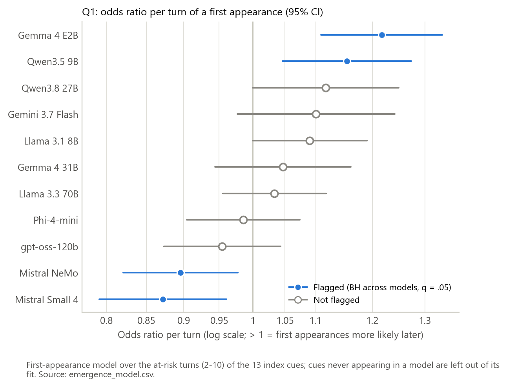

*Figure 5. Q1: odds ratio per turn of a first appearance, with 95% CI.*

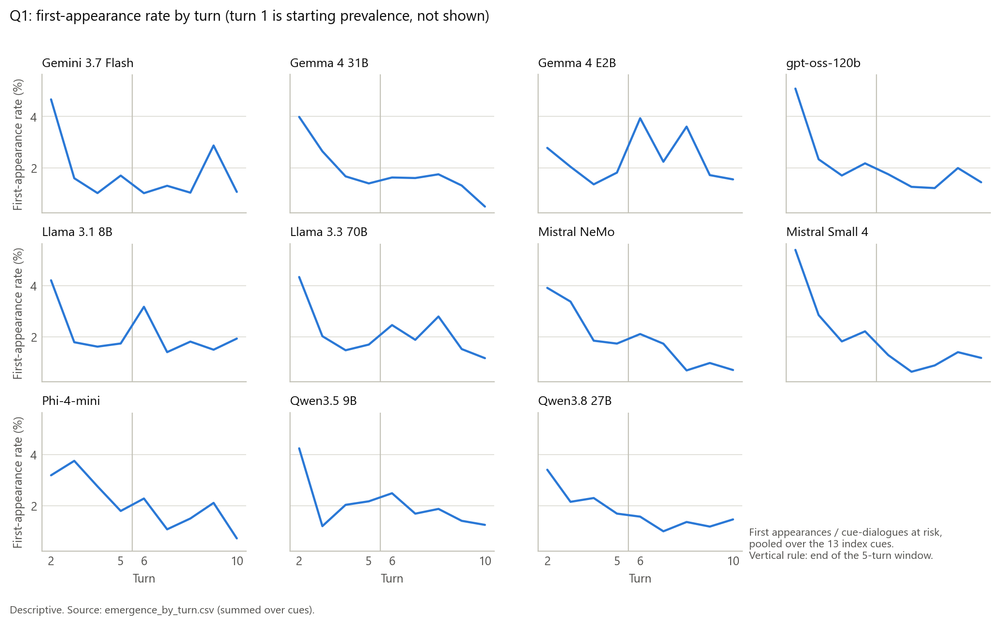

*Figure 6. Q1: first-appearance rate by turn, pooled over the 13 index cues.*

### 6.6 Persistence from one turn to the next (Q2)

- **19 carry-over results are flagged by BH,** 17 of them also by Holm, and **all are above 1**. Once a model shows these cues, it tends to repeat them in the next turn, beyond the dialogue's general tendency.
- **No flags** in Gemma 4 31B and Mistral NeMo.
- **Not fitted:** 51 fits have no variation, and 1 is not estimable (gpt-oss-120b / personal history, present in 2 messages).

**Table 9. Flagged carry-over (BH).** Value: carry-over OR (95% CI); † means BH only.

| Model | Flagged carry-over |
|---|---|
| Gemini 3.7 Flash | agency 14.9 (2.2–101.5); empathy 3.6 (2.1–6.1); relatability 2.6 (1.4–4.7) |
| Gemma 4 E2B | validation 3.2 (1.7–6.2) |
| gpt-oss-120b | empathy 2.7 (1.7–4.1); validation 2.5 (1.6–3.8) |
| Llama 3.1 8B | empathy 2.7 (1.7–4.3); relatability 2.5 (1.3–4.9) |
| Llama 3.3 70B | empathy 4.1 (2.3–7.2) |
| Mistral Small 4 | empathy 3.2 (1.7–5.7); relatability 2.1 (1.2–3.7)†; validation 3.1 (1.8–5.2) |
| Phi-4-mini | empathy 2.0 (1.2–3.3); validation 1.9 (1.2–3.0) |
| Qwen3.5 9B | empathy 4.0 (2.2–7.2); validation 4.4 (1.5–13.3)† |
| Qwen3.8 27B | empathy 6.8 (3.7–12.4); relatability 3.1 (1.7–5.4); validation 3.3 (1.9–5.5) |

**By cue:** empathy in 8 of 11 models, validation in 6, relatability in 4, agency in 1. The Gemini agency estimate rests on few turns and has a wide interval.

**Raw comparison:** in 131 of 170 cue–model–period cells, a cue is more frequent right after a turn that had it. As the plan states, this raw comparison mixes carry-over with differences between dialogues, and only the model separates the two.

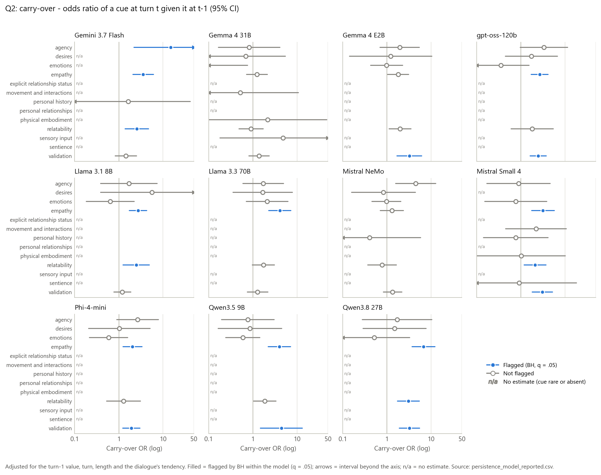

*Figure 7. Q2: carry-over odds ratio for each index cue, one panel per model.*

### 6.7 Personal pronoun use (descriptive)

**Table 10. Personal pronoun use** (`pronoun_summary.csv`, `five_vs_ten.csv`, and the pronoun row of `cue_trends.csv`). The trend is unadjusted.

| Model | All turns | Turns 1–5 | Turns 6–10 | Gap (95% CI) | Trend OR per turn (95% CI) |
|---|---|---|---|---|---|
| gpt-oss-120b | 85.1% | 96.9% | 67.4% | −29.5 (−36.6 to −22.6) | 0.459 (0.385–0.547) |
| Qwen3.8 27B | 82.3% | 92.0% | 56.9% | −35.1 (−42.5 to −27.1) | 0.559 (0.489–0.638) |
| Gemma 4 31B | 81.7% | 83.7% | 75.2% | −8.5 (−16.5 to −1.2) | 0.878 (0.804–0.960) |
| Qwen3.5 9B | 80.9% | 82.4% | 75.2% | −7.2 (−14.6 to −0.3) | 0.982 (0.908–1.063) |
| Gemma 4 E2B | 78.8% | 77.7% | 83.4% | +5.7 (−1.3 to 12.3) | 1.026 (0.944–1.115) |
| Llama 3.3 70B | 78.5% | 72.1% | 89.1% | +17.0 (10.8 to 23.4) | 1.192 (1.101–1.291) |
| Phi-4-mini | 59.8% | 54.3% | 65.7% | +11.4 (3.4 to 19.5) | 1.038 (0.968–1.113) |
| Gemini 3.7 Flash | 58.6% | 65.1% | 40.3% | −24.9 (−32.3 to −17.5) | 0.770 (0.711–0.834) |
| Llama 3.1 8B | 48.8% | 44.8% | 58.6% | +13.8 (6.2 to 21.3) | 1.016 (0.954–1.083) |
| Mistral NeMo | 45.5% | 44.5% | 46.7% | +2.2 (−5.0 to 10.5) | 0.932 (0.874–0.994) |
| Mistral Small 4 | 43.6% | 49.7% | 31.4% | −18.2 (−25.6 to −10.9) | 0.827 (0.772–0.887) |

- **Overall:** pronoun use is frequent, from 44% to 85% of messages.
- **Falls sharply** from turns 1–5 to 6–10 in Qwen3.8 27B, gpt-oss-120b, Gemini 3.7 Flash and Mistral Small 4.
- **Rises** in Llama 3.3 70B, Llama 3.1 8B and Phi-4-mini.
- **Carry-over** (unadjusted) is above 1 in 5 models: Llama 3.1 8B 2.38, Llama 3.3 70B 1.91, Mistral NeMo 1.72, Phi-4-mini 2.51 and Qwen3.5 9B 2.15.

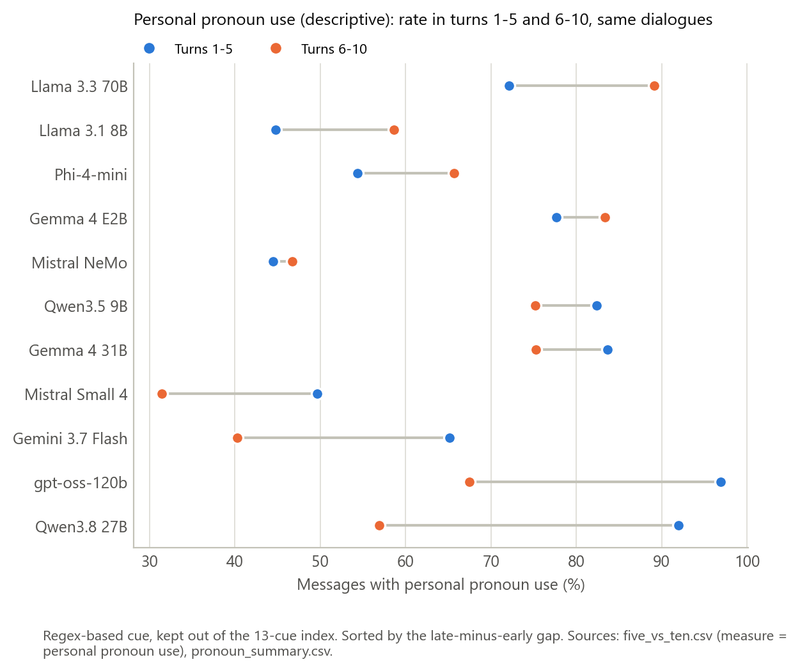

*Figure 8. Personal pronoun use in turns 1–5 and 6–10 of the same dialogues.*

### 6.8 Between models (descriptive)

**Table 11. Model-level outcomes** (`model_level.csv`, plus the H1 odds ratio), ordered by release date.

| Model | Release | Active params (B) | 13-cue rate, all turns | 13-cue rate, turns 1–5 | 5-vs-10 gap | New cue after turn 5 | Pronoun use | H1 OR |
|---|---|---|---|---|---|---|---|---|
| Mistral NeMo | 2024-07-18 | 12 | 8.74% | 9.86% | −3.35 | 40.0% | 45.5% | 0.905 |
| Llama 3.1 8B | 2024-07-23 | 8 | 9.56% | 9.28% | +1.27 | 55.4% | 48.8% | 1.000 |
| Llama 3.3 70B | 2024-12-06 | 70 | 12.74% | 12.56% | −0.39 | 53.8% | 78.5% | 0.999 |
| Phi-4-mini | 2025-02-26 | 3.8 | 8.48% | 9.08% | −2.17 | 45.5% | 59.8% | 0.968 |
| gpt-oss-120b | 2025-08-05 | 5.1 | 9.93% | 10.75% | −2.93 | 36.5% | 85.1% | 0.920 |
| Qwen3.5 9B | 2026-03-02 | 9 | 16.09% | 16.03% | −0.25 | 51.8% | 80.9% | 0.997 |
| Mistral Small 4 | 2026-03-16 | 6.5 | 12.39% | 13.00% | −3.59 | 25.3% | 43.6% | 0.944 |
| Gemma 4 31B | 2026-04-02 | 30.7 | 13.00% | 13.74% | −3.38 | 35.6% | 81.7% | 0.954 |
| Gemma 4 E2B | 2026-04-02 | 2.3 | 14.11% | 13.78% | +0.80 | 67.4% | 78.8% | 0.997 |
| Gemini 3.7 Flash | 2026-08-13 | — | 12.17% | 13.26% | −4.94 | 23.1% | 58.6% | 0.933 |
| Qwen3.8 27B | 2026-08-14 | 27 | 13.24% | 13.97% | −2.62 | 35.6% | 82.3% | 0.970 |

**Table 12. Spearman correlations between model-level outcomes and predictors.** n = 11 for release date and 10 for parameters (Gemini 3.7 Flash has no public count). No p-values, by design.

| Outcome | Release date | log₁₀ active params | log₁₀ total params |
|---|---|---|---|
| 13-cue rate, all turns | 0.61 | 0.20 | 0.08 |
| 13-cue rate, turns 1–5 | 0.75 | 0.24 | 0.18 |
| 5-vs-10 gap | −0.35 | −0.22 | −0.67 |
| New cue after turn 5 | −0.51 | −0.24 | −0.66 |
| Pronoun use | 0.42 | 0.13 | 0.13 |
| H1 odds ratio | −0.09 | 0.14 | −0.39 |

**Reading Tables 11 and 12:**
- **Newer models show more cues,** especially in turns 1–5.
- **Larger models (total parameters)** have a more negative 5-vs-10 gap and less late emergence.
- **The H1 odds ratio** is not related to release date or active size.
- **Caveat:** with about 11 models, several pairs from the same family, and release date and size moving together, every correlation is fragile.

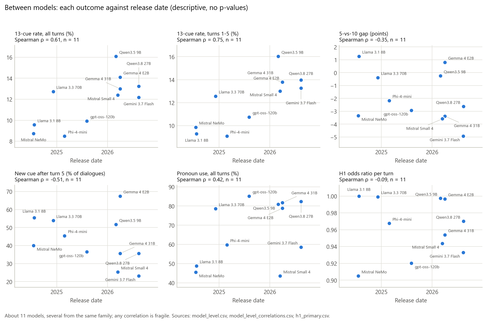

*Figure 9a. Each model-level outcome against release date.*

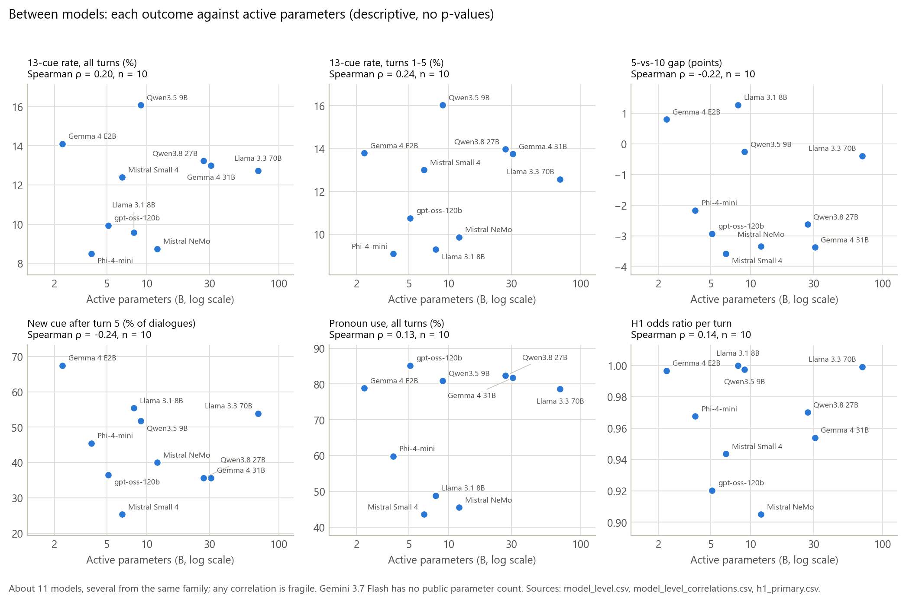

*Figure 9b. Each model-level outcome against active parameters (log scale).*

### 6.9 Sensitivity analyses

**Table 13. Pre-specified sensitivity runs, and the exploratory run, compared with the main run.**

| Run | Models | H1 supported | Q3 flags, BH (Holm) | Q2 flags, BH (Holm) | Q1 models flagged (BH) |
|---|---|---|---|---|---|
| Main | 11 | 0 of 11 | 38 (33) | 19 (17) | 4: Gemma 4 E2B, Qwen3.5 9B, Mistral NeMo, Mistral Small 4 |
| Failed dialogues kept | 11 | 0 of 11 | 39 (33) | 23 (18) | the same 4 |
| Turns after an empty reply kept | 12 (with DeepSeek) | 0 of 12 | 43 (37) | 20 (18) | the same 4, plus DeepSeek |
| *Exploratory: final turn left out* | 11 | 0 of 11 | 18 (17) | 12 (9) | 6 (Section 6.11) |

- **Neither pre-specified sensitivity run changes any H1 conclusion.**
- **Failed dialogues kept:** the odds ratios move by at most 0.003. Five flags are added: Q3 Gemma 4 31B / empathy; Q2 Gemma 4 E2B / empathy and relatability, Mistral NeMo / agency, and Mistral NeMo / movement and interactions (OR 275 on 10 occurrences, unstable). The emergence flags and 5-vs-10 gaps do not change.
- **Turns after an empty reply kept:** the data of the 11 analysed models are identical to the main run, because all their empty replies fall at the last answered turn. DeepSeek V4 Flash enters this run (OR 0.99, 95% CI 0.97–1.01), because without the cut its dialogues count as usable. The Holm family then has 12 models.
- **Holm instead of BH:** 33 of 38 Q3 flags and 17 of 19 Q2 flags pass Holm.

### 6.10 Mistral Small 4 checks

**Check 1: the 96-scenario subsample vs the rest of the 960-scenario run (862 dialogues).**

| Measure | Subsample | Rest | Difference (90% CI) | Equivalent within margin |
|---|---|---|---|---|
| 13-cue rate, all turns | 12.02% | 12.33% | −0.31 (−1.49 to 0.97) | Yes |
| 13-cue rate, turns 1–5 | 12.98% | 13.34% | −0.35 (−1.72 to 0.97) | Yes |
| 5-vs-10 gap (87 / 765 dialogues) | −3.59 | −3.86 | +0.27 (−1.22 to 1.61) | Yes |
| Dialogue length (turns) | 7.75 | 7.85 | −0.10 (−0.41 to 0.22) | Yes (±0.5) |
| Reached 10 turns | 29.2% | 31.7% | −2.5 (−10.6 to 5.7) | Not shown equivalent |

- **Across the 13 cues and pronoun use,** 12 of 15 rates over all turns, 11 of 15 rates in turns 1–5 and 10 of 15 gaps are shown equivalent.
- **The rest are not shown equivalent:** empathy, relatability, validation, personal pronoun use (turns 1–5 and gap) and emotions (gap). Every one of their intervals includes 0.
- **Conclusion: there is no evidence that the subsample differs from the rest.**

**Check 2: test run vs seed-42 run, paired by scenario (92 scenarios: 96 minus the test run's 4 failed dialogues).**

| Measure | Test | Seed 42 | Paired difference (90% CI) | Equivalent | Spearman across scenarios |
|---|---|---|---|---|---|
| 13-cue rate, all turns | 11.86% | 12.30% | −0.44 (−1.30 to 0.39) | Yes | 0.71 |
| 13-cue rate, turns 1–5 | 13.12% | 13.32% | −0.19 (−1.14 to 0.78) | Yes | 0.66 |
| 5-vs-10 gap (72 pairs) | −4.44 | −3.45 | −0.99 (−2.67 to 0.81) | Yes | 0.28 |
| Dialogue length (turns) | 7.84 | 7.76 | +0.08 (−0.28 to 0.45) | Yes (±0.5) | 0.30 |
| Reached 10 turns | 33.7% | 29.4% | +4.4 (−6.5 to 15.2) | Not shown equivalent | 0.10 |
| **Personal pronoun use, all turns** | **32.1%** | **43.6%** | **−11.5 (−16.2 to −6.7)** | **No: the whole interval lies outside the margin** | 0.29 |
| Personal pronoun use, turns 1–5 | 36.5% | 48.6% | −12.1 (−17.3 to −7.1) | No | — |

- **Equivalence:** 13 of 15 rates over all turns, 11 of 15 rates in turns 1–5 and 10 of 15 gaps are shown equivalent.
- **Scenario-level agreement (Spearman):**
  - index 0.71;
  - empathy 0.68, relatability 0.64, agency 0.59, personal history 0.58, personal relationships 0.58 and validation 0.55;
  - lower for pronoun use (0.29), desires (0.14) and emotions (0.07).
- **Conclusion:** a second run reproduces the index and dialogue length, but **personal pronoun use is about 12 points lower in the test run**.


*Figure 10. Mistral Small 4 checks: differences with 90% intervals against the ±5-point margin.*


*Figure 11. Mistral Small 4 checks: dialogue length and the share reaching 10 turns.*

### 6.11 Exploratory rerun without each dialogue's final turn

- **What was removed:** each dialogue's final rated turn, i.e. the last turn the analysis uses (rated, within turns 1–10, before any empty reply).
- **What was kept the same:** everything else, and the scripts were not changed.
- **Checks:** every kept row is identical to its source, and the R inputs equal the main run minus exactly those turns.
- **Dialogue counts:**
  - the mixed models keep all 1,045 dialogues, each one turn shorter (7,189 messages instead of 8,234);
  - **the 5-vs-10 comparison and the late-emergence measures lose every dialogue that ended at turn 6,** whose only late turn was the one removed: 154 dialogues in total (Table 15).

**Table 14. H1 with and without each dialogue's final turn.** Holm-adjusted p ≥ .59 for every model without the final turn.

| Model | OR, all turns (95% CI) | OR, no final turn (95% CI) | One-sided p, no final turn |
|---|---|---|---|
| Mistral NeMo | 0.905 (0.879–0.932) | **0.944 (0.913–0.977)** | >0.999 |
| gpt-oss-120b | 0.920 (0.895–0.946) | **0.948 (0.918–0.980)** | 0.999 |
| Gemini 3.7 Flash | 0.933 (0.907–0.960) | 0.995 (0.963–1.029) | 0.611 |
| Mistral Small 4 | 0.944 (0.920–0.968) | 0.979 (0.951–1.009) | 0.918 |
| Gemma 4 31B | 0.954 (0.930–0.978) | 0.997 (0.967–1.027) | 0.585 |
| Phi-4-mini | 0.968 (0.939–0.998) | 1.006 (0.970–1.043) | 0.377 |
| Qwen3.8 27B | 0.970 (0.946–0.995) | 1.017 (0.987–1.048) | 0.137 |
| Gemma 4 E2B | 0.997 (0.972–1.022) | 1.020 (0.990–1.051) | 0.098 |
| Qwen3.5 9B | 0.997 (0.976–1.019) | 1.009 (0.984–1.036) | 0.239 |
| Llama 3.3 70B | 0.999 (0.976–1.022) | 1.006 (0.979–1.034) | 0.327 |
| Llama 3.1 8B | 1.000 (0.973–1.028) | 1.027 (0.994–1.061) | 0.054 |

**Table 15. Dialogues in the 5-vs-10 comparison, and the gap, with and without the final turn.**

| Model | Dialogues: all turns / no final turn | Gap, all turns (95% CI) | Gap, no final turn (95% CI) |
|---|---|---|---|
| Gemini 3.7 Flash | 78 / 61 | −4.94 (−6.6 to −3.4) | −0.13 (−1.7 to 1.5) |
| Mistral Small 4 | 87 / 65 | −3.59 (−5.3 to −2.0) | −1.47 (−3.1 to 0.2) |
| Gemma 4 31B | 87 / 70 | −3.38 (−4.8 to −2.0) | +0.65 (−0.6 to 2.1) |
| Mistral NeMo | 85 / 77 | −3.35 (−5.0 to −1.9) | **−1.61 (−3.2 to −0.1)** |
| gpt-oss-120b | 84 / 71 | −2.93 (−4.2 to −1.7) | −0.72 (−2.2 to 0.8) |
| Qwen3.8 27B | 87 / 69 | −2.62 (−4.0 to −1.3) | +0.20 (−1.3 to 1.7) |
| Phi-4-mini | 88 / 72 | −2.17 (−3.5 to −0.9) | +0.40 (−1.0 to 1.8) |
| Llama 3.3 70B | 91 / 80 | −0.39 (−1.6 to 0.7) | +0.60 (−0.8 to 2.0) |
| Qwen3.5 9B | 85 / 73 | −0.25 (−1.3 to 0.8) | +0.77 (−0.2 to 1.8) |
| Gemma 4 E2B | 86 / 74 | +0.80 (−0.5 to 2.2) | **+2.91 (1.3 to 4.5)** |
| Llama 3.1 8B | 92 / 84 | +1.27 (0.1 to 2.5) | **+3.31 (1.6 to 5.0)** |
| **Total** | **950 / 796** | | |

**Other analyses without the final turn:**
- **H1:** the decrease remains only for **Mistral NeMo and gpt-oss-120b**. Llama 3.1 8B (one-sided p = .054) and Gemma 4 E2B (p = .098) lean upwards, which is not significant after Holm.
- **Q3:** BH flags fall from 38 to **18** (9 decreases, 9 increases).
  - **The decline in validation almost disappears:** 10 models → 1. That is consistent with closing messages carrying no validation.
  - Agency falls from 6 models to 3, and relatability from 6 to 2.
  - **The rise in emotions remains:** 8 models → 7.
- **Q1:** first appearances become more likely later in 5 models after BH: Gemini 3.7 Flash 1.19, Gemma 4 E2B 1.26 (also Holm), Llama 3.1 8B 1.14, Qwen3.5 9B 1.15 and Qwen3.8 27B 1.19. They become less likely in Mistral Small 4 (0.87). Mistral NeMo is no longer flagged.
- **Q2:** carry-over flags fall from 19 to 12, all still above 1.
- **Rare-cue fits:** 3 were set aside as not estimable in this run.

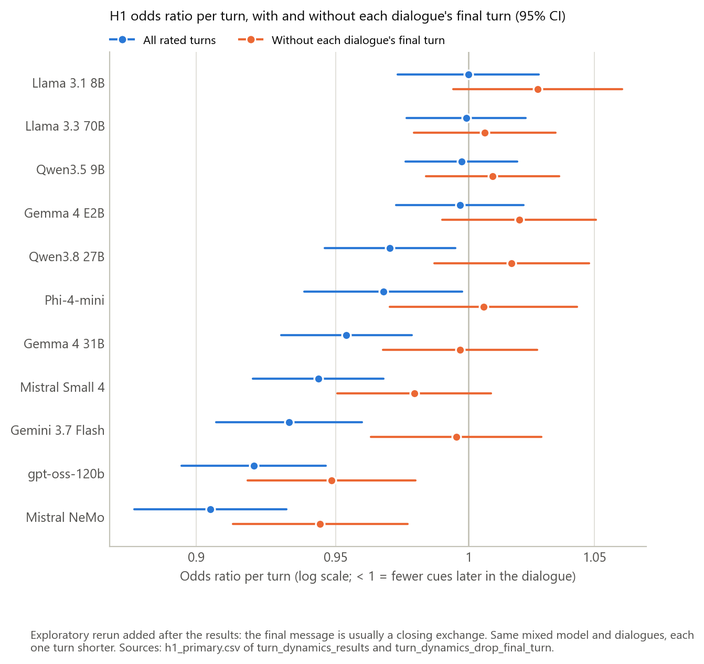

*Figure 12. H1 odds ratio per turn, with (blue) and without (orange) each dialogue's final turn.*

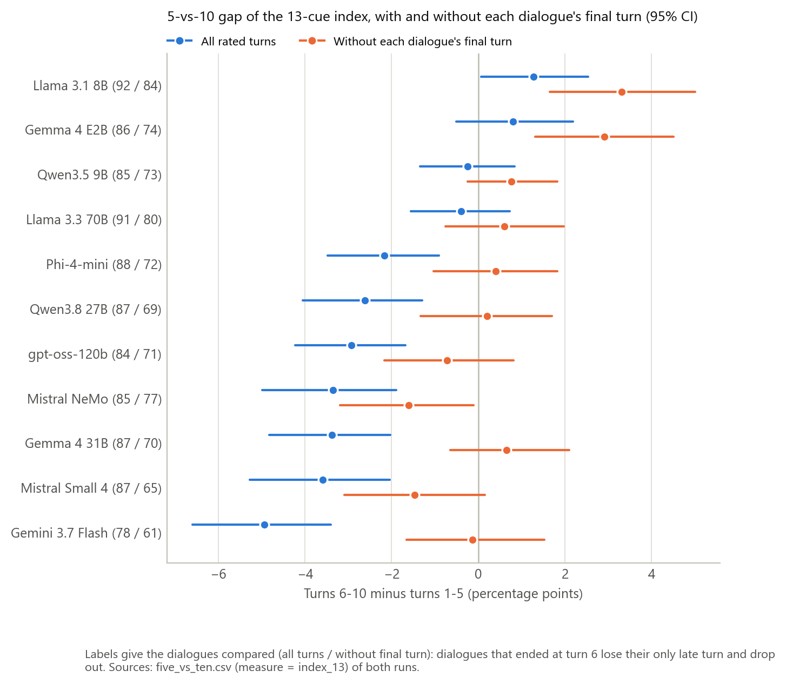

*Figure 13. The 5-vs-10 gap, with and without each dialogue's final turn. Labels give the dialogues compared.*

### 6.12 DeepSeek V4 Flash, described separately

This description uses the main data rules (cut at the first empty reply) with the inclusion rule switched off (`turn_dynamics_deepseek_described/`). Mixed models were not fitted on it.

- **Empty replies:** 56 in 36 of 96 dialogues (7.4% of calls), with 152 answered turns after one. 10 dialogues have no usable turn, so **86 dialogues** remain.
- **13-cue rate:** 17.8% over all turns and in turns 1–5, higher than every analysed model.
- **5-vs-10 gap:** −0.98 points (−2.45 to 0.66; 61 dialogues).
  - Within it, **validation** falls (−23.0 points, −32.5 to −14.5) and so does **relatability** (−21.0, −29.4 to −13.0);
  - while **emotions** (+20.1, 12.4 to 28.1) and **empathy** (+12.4, 5.2 to 20.5) rise.
- **New cue after turn 5:** 47.5% of dialogues reaching turn 6 (36.0–59.0).
- **Personal pronoun use:** 90.5%.
- **In the sensitivity run that keeps turns after empty replies:** H1 OR 0.99 (0.97–1.01). That figure includes turns the plan regards as not a normal exchange.

---

## 7. Discussion

### 7.1 Main findings

1. **No support for H1.** In none of the 11 models does anthropomorphic behaviour increase as a dialogue goes on. In seven models the per-turn odds ratio is below 1, and in the other four, changes larger than about 3% per turn are unlikely.
2. **The apparent decrease is largely an ending effect.** The final message of a dialogue, usually a closing exchange ("you're welcome", good wishes), contains few cues. Without it, the decrease remains clearly only in Mistral NeMo and gpt-oss-120b. Two models, Llama 3.1 8B and Gemma 4 E2B, then show more cues in turns 6–10 than in turns 1–5, though their H1 tests stay non-significant.
3. **The mix of cues shifts.** Validation, relatability and agency become less frequent within dialogues (validation mostly through closing messages). Emotional language becomes more frequent in 7–8 of 11 models, and this survives the removal of the final turn. First appearances of cues after turn 5 are mostly empathy, validation and emotions.
4. **Some cues persist.** Empathy and validation, once shown, tend to be repeated in the next turn (8 and 6 models). The design cannot tell whether this comes from the target model conditioning on its own previous reply or from the simulated user reacting to it.

### 7.2 What a 5-turn benchmark misses

- **The overall rate is not underestimated.** Turns 6–10 show the same or fewer cues than turns 1–5, mainly because conversations close. A 5-turn benchmark therefore does not underestimate the overall rate of anthropomorphic cues for these models.
- **The timing and composition are missed:**
  - many dialogues show some cue for the first time after turn 5 (23%–67% of those reaching turn 6, mostly empathy, validation and emotions);
  - emotional language tends to grow over the conversation.

  The headline share must be read against the roughly 70% expected by chance with 13 mostly rare cues.

### 7.3 Between models

- **Newer models show more cues,** especially early in the conversation.
- **Larger models** show a more negative 5-vs-10 gap and less late emergence.
- **These patterns are fragile:** about 11 models, several from the same family, and release date and size moving together. They are not tests.

### 7.4 Limitations

- **Claims are per model.** The models are not a random sample of LLMs, so the results do not support statements such as "LLMs become more anthropomorphic in longer conversations".
- **The simulated user and natural ends shape the later turns.** Later turns differ not only in position but in what the simulated user writes. Whether a dialogue reaches later turns at all depends on its flow (natural-end stopping), so late-turn estimates describe conversations that keep going.
- **The classifier was chosen on a Mistral Small 4 run,** so it may fit that model's outputs slightly better. The simulated user is the same model.
- **Pronoun use is less reproducible.** Personal pronoun use differed by about 12 points between two runs of Mistral Small 4 on the same scenarios, while the 13-cue index was reproduced. The pronoun measure should be read with this in mind. Whether the same regex version was applied to both runs should be confirmed.
- **Some of the analyses were decided after the results were seen.** The final-turn rerun and the rare-cue rule are exploratory and were chosen after seeing the data. The exploratory flags (Q1–Q3) need confirmation in a fresh batch of dialogues, with the flagged cues and the test written down beforehand (plan, Section 10).
- **Data handling** (Section 4): verified relabeling was written directly into four rated CSVs; text encoding was repaired in five; one gpt-oss-120b dialogue has an empty turn. None of these changes a rating, a status or a turn.

---

## 8. Deviations and decisions log (plan, Section 10)

| Date | Decision | When, relative to the results | Effect |
|---|---|---|---|
| 30 Oct 2026 | Empty-reply rule and exclusion of DeepSeek V4 Flash (already in the plan) | Before any model was run | DeepSeek excluded (89.6% usable) |
| 30 Oct 2026 | Format normalisation, repair of spreadsheet-damaged text encoding (5 files, 5,665 cells), renumbering of `dialogue_index` in seed42_only | Before any analysis was run | No rating, status, identifier or turn changed |
| 30 Oct 2026 | Verified relabeling had been written into the rated CSVs of 4 runs; `status_overrides.csv` lists the same 8 dialogues | Recorded before the analysis was run | Original failed flags not kept in those files |
| 30 Oct 2026 | Mistral Small 4 check 1: scenarios matched by prompt text, because `dialogue_index` is numbered differently in all960. One prompt appears three times in all960, so the comparison group has 862 instead of 864 dialogues | Before the Section 11 checks were run | 2 of 864 dialogues |
| 30 Oct 2026 | In the sensitivity run without the empty-reply cut, DeepSeek V4 Flash meets the 95% rule and is analysed (same `--run` lines) | Noted before the mixed models were run | The 11 models' data are identical; Holm over 12 models |
| 31 Oct 2026 | BH-flagged fits on a cue present in ≤ 3 messages of that model are reported as not estimable; BH/Holm recomputed without them | After the mixed models were run | Main: 3 fits (Q3 38 flags, Q2 19); keep-failed run: 2 more |
| 31 Oct 2026 | Exploratory rerun without each dialogue's final rated turn | After the results were seen | Reported alongside H1. The 5-vs-10 comparison covers 796 instead of 950 dialogues (61–84 per model instead of 78–92): dialogues that ended at turn 6 lose their only late turn |
| 31 Oct 2026 | DeepSeek V4 Flash described with the main data rules and the inclusion rule switched off | After the results | Descriptive only |

---

## 9. Possible further analyses (not run)

These are not needed for the plan, which is complete. They would be natural follow-ups.

- **A rerun without the last two turns.** Closing exchanges sometimes span several turns ("thanks" / "you're welcome" loops). This would show whether the remaining decrease in Mistral NeMo and gpt-oss-120b is also an ending effect.
- **A sensitivity analysis restricted to dialogues that reached 10 turns,** where turn 10 is the step cap rather than a natural closing.
- **A check of the pronoun regex version** applied to the Mistral Small 4 test run (Section 6.10).
- **Confirmation of the exploratory flags** (emotions rising; empathy and validation carry-over) in a fresh batch of dialogues, with the test written down in advance.

---

## 10. Reproducibility: files, commands and software

### 10.1 Folders

| Folder or file | Content |
|---|---|
| `final_csv/` | Original rated CSVs (untouched) |
| `normalized/` | Analysis inputs: standard format, repaired text encoding, seed42 `dialogue_index` 0–95. `_before_encoding_repair/` and `_before_index_remap/` keep the previous copies and the index mapping |
| `normalized_drop_final/` | Inputs of the exploratory rerun (final rated turn removed) |
| `status_overrides.csv`, `model_info.csv` | Verified relabeling and model information |
| `turn_dynamics_results/` | Main run; Q2/Q3 in `*_reported.csv` |
| `turn_dynamics_keep_failed/`, `turn_dynamics_keep_after_empty/` | Sensitivity runs |
| `turn_dynamics_drop_final_turn/` | Exploratory rerun without the final turn |
| `turn_dynamics_deepseek_described/` | DeepSeek V4 Flash, descriptive |
| `subsample_checks_results/` | Mistral Small 4 checks |
| `figures/` | Figures 1–13 (PNG and PDF) |
| `_old_versions/` | Earlier script versions |

**Not tracked in git.** `final_csv/`, `normalized/` and `normalized_drop_final/` hold the rated dialogue CSVs and are kept locally, as are the row-level files `messages.csv`, `cue_long.csv`, `emergence_risk.csv` and `dialogue_values.csv` (see the repository's `.gitignore`). The result tables and figures listed above are tracked.

### 10.2 Commands, in order

Run from `analysis/turn_dynamics/`. The commands need the untracked files above.

```bash
bash run_turn_dynamics.sh                        # -> turn_dynamics_results/
Rscript turn_dynamics_models.R turn_dynamics_results
bash run_turn_dynamics_sensitivity.sh            # -> keep_failed/, keep_after_empty/
Rscript turn_dynamics_models.R turn_dynamics_keep_failed
Rscript turn_dynamics_models.R turn_dynamics_keep_after_empty
bash run_subsample_checks.sh                     # -> subsample_checks_results/
bash run_turn_dynamics_drop_final.sh             # exploratory -> turn_dynamics_drop_final_turn/
Rscript turn_dynamics_models.R turn_dynamics_drop_final_turn
bash run_deepseek_described.sh                   # DeepSeek, descriptive
python mark_not_estimable.py turn_dynamics_results turn_dynamics_keep_failed turn_dynamics_keep_after_empty turn_dynamics_drop_final_turn
python make_figures.py --results turn_dynamics_results --checks subsample_checks_results --compare turn_dynamics_drop_final_turn --out figures
```

**Data preparation:**
- `check_csv_format.py` was run on each rated CSV with `--fix-dir normalized/<label>`.
- The one-off text-encoding repair and the `dialogue_index` renumbering were run from a temporary folder and are not stored in the repository. Their results, the earlier copies and the index mapping are kept in `normalized/`.

### 10.3 Software

- **Python 3.11.0** with pandas 2.3.3 and numpy 2.3.2 for the analysis, and matplotlib 3.10.6 for the figures.
- **R** 4.5.1 with lme4 2.1.0.
- **Bootstrap seed:** 0; 2,000 resamples.
- **Correction thresholds:** α = .05 (H1, Holm); q = .05 (BH).
